  

  
  
  

  

---

## 🧵 Right now

| | |
|---|---|
| 🔨 **Building** | **Portuna**, **MyTartan** and **Desir** — see below |
| 📚 **Learning** | software engineering at CMU · system design · web3 |
| 📍 **Based in** | Doha, Qatar · CMU |

last updated: Nov 2026 — update this table whenever you switch projects, it's the first thing people read.

## 🤝 Open to

- 💼 **Internships / new-grad roles** in software engineering — full-stack, backend, or anything with a good problem
- 🛠️ **Collabs & side projects** — hackathon teams, early-stage products, open source
- ⛓️ **Weird ideas** — blockchain / supply-chain transparency, fashion-tech, tools for people who build
- ☕ **Coffee chats** — about CMU, SWE, or whatever you're making

> 📬 Best way to reach me: [rymameuri@gmail.com](mailto:rymameuri@gmail.com)

## 🔨 Currently building

| Project | What it is | Stack |
|---|---|---|
| **Portuna** | An "opportunities tinder" for youth — swipe through opportunities that fit you | TypeScript |
| **MyTartan** | A conversational AI platform built around CMU's Scottish terrier mascot: student Q&A, campus guide, chat companion and academic tutor modes | JavaScript |
| **Desir** | Organize your wishlist and save up for it, with an iOS app version | JavaScript · Swift |

## ✨ Things I've built

| Project | What it is | Stack |
|---|---|---|
| **Qatar Scam Shield** | Bilingual (Arabic/English) app that helps people in Qatar tell if a message, link or call is a scam, and teaches them the scams going around | Python |
| **Baraka** | Bilingual (Arabic/English) sustainability app for Qatar | Swift |
| **UniGuide** | Bilingual AI student counseling platform for MENA — meet Rocco 🦊, who gives personalized guidance on academics and careers | TypeScript |
| **Quik** | Swipeable micro-learning for Gen Z — real knowledge for interview prep without long reads | Swift |
| **GAP.** | Finds the misconceptions behind students' wrong answers, clusters them across a class, and helps teachers close them | TypeScript |
| **Resource Alerts** | Campus catalogue where staff and student orgs post surplus materials so others can claim them before they're thrown away | Next.js · SQLite |
| **Daybreak** | Personal AI for school and email: Canvas, Blackboard, Gmail and an assistant that knows your week | Next.js · tRPC · Postgres |
| **Research Matchmaker** | Bilingual research network for discovering people, sharing ideas and finding collaborators | TypeScript |
| [**rymameuri.com**](https://github.com/rymameuri/rymameuri.com) | My portfolio, with video demos of what I make | Next.js · Tailwind |
| **IXLab site & QMxIXLAB** | Website for the IX Lab plus 3D models of the artists' drawings | TypeScript · HTML |
| **CmuqChase** | Course project for CMU's 15-112 | Python |
| [**Blockchain**](https://github.com/rymameuri/Blockchain) | Supply chain transparency on-chain (forked and extended) | Solidity |

🔒 Most of these live in private repos — happy to walk you through any of them.

## 🧰 Toolbox

  
  
  
  
  
  

## 📊 Stats

  

  

woven with 🧶 and a lot of coffee

